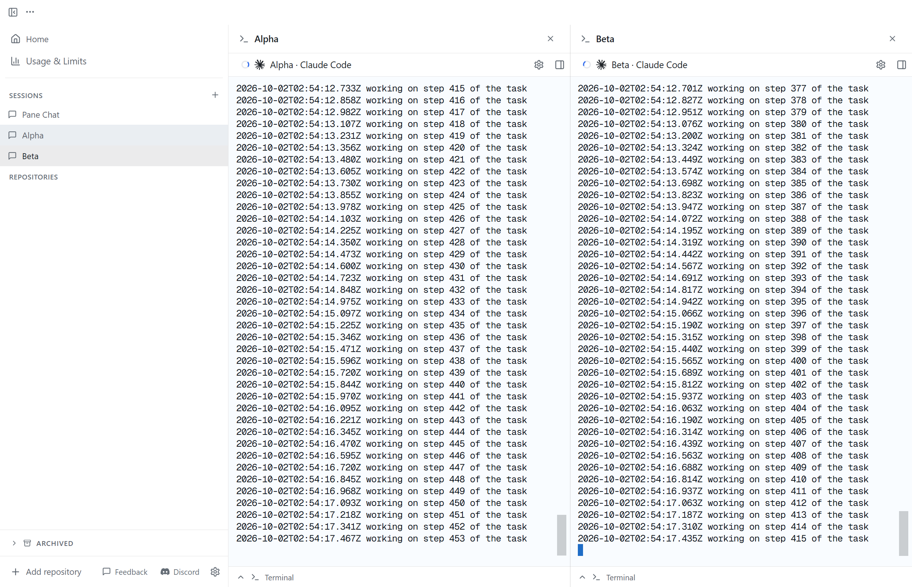

# Sessions

Sessions are named, ongoing Pane Chats where work intent lives. Each Session
opens one chat, and its sidebar row can expand to show associated Panes. The
optional overview keeps the Session name, associated Panes, and recent
activity together while the chat remains the focused work surface. A tab
shares its parent Pane's worktree.

In the sidebar, `+` opens an agent picker, an optional Session name field, and
an optional "What is this Session for?" field that becomes the Session's goal.
Pane remembers the chosen agent as the default for future Sessions while
existing Sessions keep their own agent. A blank name starts as `New chat` or
`New chat 2` and is renamed once from the first message you send the Session
agent; a name you type or set later is kept. Each new Session opens as one Pane
Chat and can be renamed later from the optional read-only overview. Expand a Session to see
its associated Panes and open any Pane in its existing sidebar view.

The Sessions section below the divider can be collapsed from its header; the
`+` remains available while it is collapsed. Sessions are opened from this
section rather than from a duplicate top navigation shortcut.

A Session is a persistent coordination conversation with its own scratch
workspace. Its default profile supports discussion, investigation, decisions,
and delegation when authorized work benefits from it. No particular skill,
ticket system, model, or Agent Farm installation is required. Users can select
skills and workflows without Pane imposing an implementation pipeline.

## Upgrading from Pane Chat

Existing Pane Chat opens under Sessions automatically, keeping its name and all
agent conversations together. Switching agents resumes that agent's existing
panel and history in the same stable private Session workspace. Opening the
Session does not submit a prompt or authorize new work.

Earlier development versions split old agent histories into supplemental
Sessions. Untouched imports with only generated workspace files and no competing
conversation are reunited with the original Session. Imports with files, settings changes, or
additional conversations remain separate to preserve that work. Those retained
Sessions receive independent internal owners while keeping their names, folders,
panel IDs, saved histories, and settings. Interrupted ownership moves resume on
startup; no transcript or workspace files are deleted by this migration.

## Launch configuration and profile

Sessions use the same built-in launch presets and saved custom commands as
ordinary project/worktree panels, including custom arguments. The application
default seeds new Sessions. Creating a Session remembers its launch command and
arguments for the next creation; cancelling leaves that default unchanged.
Selecting the agent default clears the remembered custom command. Each Session saves its own launch configuration
and behavior profile. Changing defaults does not overwrite existing Sessions.
Launch changes take effect on the next explicit restart.
Use **Edit behavior…** during creation or in Session settings to open the
separate profile editor. **Back** discards the draft; **Save behavior** applies it
to the form, which is persisted when you create the Session or save settings.

The command, behavior profile, and saved task context have separate purposes.
A command selects how the agent runs; a profile describes how it should behave;
saved goals, decisions, and next actions help it respond to later user input.
Custom commands (including Agent Farm wrappers) retain their arguments. Pane
only adds native flags through compatible built-in adapters, an explicit custom
command resume config, or Agent Farm's resume contract (see
[Resuming custom launchers](#resuming-custom-launchers)). Wrappers keep control of
instruction discovery; apart from that one Agent Farm exception, Pane does not
infer flags from a wrapper name. A user command that explicitly starts work
remains the user's choice.

Each Session owns a stable folder at `<PANE_DIR>/sessions/<session-id>/` for
notes, plans, attachments, generated instructions, and artifacts. Renaming,
reopening, and archiving retain this folder. These folders are not Git
worktrees or security sandboxes and do not expire with OS temporary files.
Project implementation belongs in an appropriate Pane/worktree.

## Windows and WSL runtimes

On Windows, **Create Session → Run agent in** appears directly below the agent
picker when WSL reports installed distributions. Windows is the default on every
creation. Choose a named distribution to run the agent there; install the agent
inside that distribution first. Cursor is available when WSL is selected.
The runtime and distribution belong to the Session and survive reopening,
application restart, and terminal supervisor restart. Only WSL Sessions carry a
`runtime` (`"wsl"`); a Session on the native host omits it on every OS. Older
records that stored `"windows"` for the native host lose the field when read.
If creation fails before publishing a terminal owner, Pane removes untouched
generated files so the name can be retried; user files or edits prevent rollback.

WSL Sessions retain their durable files under the Windows Pane data directory.
Their agent sees Linux paths such as `/mnt/c/Users/.../.pane/sessions/...`.
This uses Pane's existing Windows-to-WSL path conversion and requires the default
`/mnt/<drive>` automount layout; custom `[automount] root` settings are not supported.
Generated `AGENTS.md` points to a Session-specific `runtime-context.md`; this
context takes precedence over the shared Pane Chat routing instructions.

Each WSL Session gets a managed `.pane-runtime/runpane` wrapper on PATH, also
available as `$PANE_RUNPANE_BIN`. It invokes this build's bundled Windows CLI via
PowerShell interop from Windows TEMP, so the CLI can reach this Pane instance's
named pipe. Arguments cross as JSON to preserve quotes and Unicode. Temporary
files beside the bridge carry payloads without Windows command-line size limits
and are removed when the call exits; stdin remains available to the CLI. File flags
accept relative or absolute Linux paths (including `--flag=value`); `-` retains
stdin semantics. `--repo` translates absolute Linux paths and explicit relative
paths (`.`, `..`, `./...`, `../...`) while preserving repository names and IDs.
Paths inside JSON request bodies must use Windows paths, and
Windows paths returned by the CLI can be read in WSL after `wslpath -u` conversion.
The bridge pins `--pane-dir` to this instance and preserves the calling Session
and panel identities. PowerShell is invoked by its mounted Windows path, so
`appendWindowsPath=false` is supported. WSL interop must be enabled; a Linux-installed RunPane CLI
cannot replace this bridge for a Windows daemon.

For CLI JSON creation, `runtime: "wsl"` and `wslDistribution: "Ubuntu-24.04"`
select an installed distribution; omitted runtime selects the native host.
`runtime: "windows"` is still accepted as a legacy name for the native host and is
not stored.

## Resuming custom launchers

Use **Enable custom command resume** in Session launch settings or a saved custom
command's editor. This is an explicit contract, independent of executable names.
Agent Farm is the one exception, described in [Agent Farm](#agent-farm) below.
Choose a session ID source and provide first-launch and resume templates:

- **Claude:** Pane allocates a UUID and resumes it only when its transcript exists.
- **Codex / Cursor:** Pane captures the native resume ID from terminal output.
- **Pane allocates an ID:** for other CLIs that accept a caller-provided ID.
- **CLI reports its ID:** the CLI or wrapper prints a standalone newline-terminated
  `PANE_AGENT_SESSION_ID=your-session-id` line. IDs may contain letters, digits,
  periods, underscores, colons, and hyphens (up to 256 characters).

`{command}` expands to the saved command; `{sessionId}` expands to the quoted ID.
Leave the ID placeholder unquoted. For a launcher that forwards native arguments
through `--`, Claude templates could be `{command} -- --session-id {sessionId}`
and `{command} -- --resume {sessionId}`. Codex could use `{command}` initially
and `{command} -- resume {sessionId}` on resume. These are user configuration
examples, not automatic wrapper detection. Other CLIs can use other syntax.

The configuration and ID persist with the panel. Without a captured ID, Pane
uses the first-launch template instead of guessing a latest conversation. Saved
custom commands copy their resume settings into new panels; changing the saved
shortcut does not change existing panels. Session settings support changing or
disabling the contract for that Session's next launch. No prompt is submitted just
to resume. Old conversations whose IDs were never saved cannot be recovered
automatically; use an explicit resume command if you know their ID.

### Agent Farm

Agent Farm is the one launcher Pane recognizes by name, because Agent Farm
publishes this contract for Pane: when `PANE_PANEL_ID` is set it prints
`PANE_AGENT_SESSION_ID=<launch id>` once, before the agent starts, and documents
`{command} --resume <id>` as the way to reopen that conversation. Pane keeps the
first ID line of each launch and ignores later ones, which can only be agent
output. Every other wrapper still needs an explicit config.

A command counts when it is a single `agent-farm run <profile>` or
`agent-farm agent <profile>`, optionally preceded by `VAR=value` assignments,
with no shell operators, no `--`, and no `--resume` of its own. `npx`, `pnpm dlx`
and aliases do not count. Such a panel with no explicit config behaves as
**CLI reports its ID** with templates `{command}` and
`{command} --resume {sessionId}`: Pane saves the printed ID and relaunches with
it. The editor says so under the unticked checkbox. An explicit config always
wins: tick **Enable custom command resume** and set your own templates.

A panel created before this rule usually has no saved ID. On its next relaunch Pane
makes one attempt to read the last `PANE_AGENT_SESSION_ID=` line from the
panel's saved terminal buffer. Agent Farm older than 0.2.20 prints no ID, so
those panels relaunch fresh, as before.

To reopen an older conversation by hand, run
`agent-farm run <profile> --resume <id>`. The ID is the launch ID (the
`PANE_AGENT_SESSION_ID` value), shown as `resumeId` in
`runpane panels list --json`. Agent Farm keeps launch records in
`~/.local/state/agent-farm/launches/` for 90 days.

## Session sidebar and archive

Pinned is the first sidebar category and can contain both Session chats and
Panes. Right-click a Session, or use the ⋯ button that appears on hover, to pin or unpin it, or turn on **Start pinned** in
Create Session to pin it from the start. The dialog remembers that toggle for
the next Session (on the desktop in Pane's config, in the remote web app on
that device). The pin preference survives restarts; an archived Session stays
out of Pinned until it is restored. RunPane can set the same preference with
`sessions pin` or `sessions unpin --session <id|name>`. Create JSON accepts
`isPinned` (default false), and update JSON accepts it without changing the
preference when omitted.

Drag a Session up or down in Pinned, in Sessions, or in the compact rail to
change its place; a line shows where it will land. With a Session row focused,
**Alt+↑** and **Alt+↓** move it one place and a screen reader hears its new
position. A drag or keypress reorders only the list it starts in: Pinned
Sessions move among themselves, and a Session dragged across the Pinned line
stays where it was. The order is saved on the host, so every desktop, the phone
and `runpane sessions list` show it, and it survives restarts. New Sessions
start at the bottom. A host that has never saved an order lists Sessions oldest
first. A host running an older Pane cannot save an order: the list snaps back
and the error says to update Pane on that host. Dragging a Session onto the
workspace still tiles it.

Click a Session row to open its chat, or use **Switch to Session: <name>** in the
command palette (`⌘⇧P` / `Ctrl+Shift+P`), which also has **New Session**. A Session with associated Panes shows a
chevron that expands or collapses them; a Session without Panes shows none.
Every Session starts collapsed, including a new one and one that just got its
first Pane, until you press its chevron. Opening the Session's chat, an agent
adding Panes, or `runpane` focusing one of its Panes leaves it collapsed. Each
device remembers the Sessions you opened, separately for each host: the
desktop in its own settings, the remote web app (PWA) in browser storage
(`pane.remotePwa.expandedSessions@<host id>`). Opening a Session under Pinned
opens it under Sessions too. The native iOS and Android app does not follow
this yet: its Sessions start expanded and it forgets on restart.
Child Pane rows are indented beyond the Session chat icon and keep the ordinary
Pane actions. Create Pane, opened while a Session is showing, has an
**Add to <Session>** checkbox, on by default, that files the new Pane under that
Session. A Pane that belongs to a Session names it in the window title bar as
"<Session> › <Pane>"; click the Session name to go back to it. To file an
existing Pane under a Session, right-click the Pane, choose
**Add to Session**, then pick the Session. **Remove from <Session>** in the same
menu takes it out again; the Pane and its worktree are unchanged. Pinned Pane
rows show the Pane name with its repository muted beside it. Single-line Pane rows omit change counts and PR numbers; the
optional two-row layout shows those details below the title. Session and Pane
context menus use compact widths.

The experimental **Attention inbox** (Settings > Advanced > Experimental) turns
the Projects list into an Inbox of the Panes that need you: an agent waiting on
input or approval, an agent that completed a real turn since Pane started (it
worked on a prompt and went idle; a freshly started agent does not count), or a
Pane that errored. Session child rows follow the same filter, and a Session row still
counts all of its Panes. A row leaves when its agent works again; opening it
does not remove it. Hover a row and choose **Dismiss** (check mark) to hide it
until its agent works again. The row under the Inbox counts the hidden Panes
("3 running · 1 idle") and **Show all** lists every Pane. Pinned rows are
unchanged, and ⌘1–9 number the Inbox rows while it is shown.

The right sidebar has Overview, Files, and Changes tabs. Overview shows the
Session's blockers, goal, next step, and decisions when they are set, then its
Panes and recent activity. Agent state changes stay out of Activity; the status
dot shows them. Files browses the Session workspace. Changes summarizes the
Session's Panes and opens a Pane for detailed review. The upper-right sidebar
button shows or hides the selected tab. A single Session uses two rows at the
top: the window title bar shows its name and controls, and the tab strip sits
directly below it. Session file clicks open editor tabs beside the agent tab in
that strip. These tabs can be selected and closed directly, and reopening a file
restores its tab.


Right-click a Session, or use its ⋯ button, to archive it. An "Archived · Undo"
toast offers to restore it for a few seconds, and archiving the open Session
returns the desktop view to Home. Archiving hides the chat from the active
Sessions list while retaining its identity, conversation history, and Pane
associations. Its Panes and worktrees remain accessible through repository
navigation. Restore the Session from the sidebar’s Archived section. This is
separate from archiving a project Pane and does not delete delegated work.

The existing Session update contract accepts `archived: true` or
`archived: false`. List results retain archived records, in the saved order;
active navigation filters them. An archived Session keeps its place, so Undo or
Restore puts it back where it was.

`orchestration-sessions:reorder` takes `{ sessionIds }`. The listed Sessions
trade the places they already hold, so a list that shows only some Sessions
(Pinned, or the active ones while others are archived) rearranges just those;
unknown ids are ignored. It writes an optional `order` id list beside the
Sessions in `orchestration-sessions.json` (the store stays at version 1) and
changes no Session's revision, `updatedAt` or activity. An older Pane reading
the file ignores `order`, lists Sessions oldest first, and drops it the next
time it writes. Archiving the selected Session chooses an available active
Session or clears the selection if none remain. Restoring a Session does not
replace an unrelated selection.

### Move a Session to another machine

Right-click a Session, or use its ⋯ button, and choose **Move to host…** to
continue it on another machine. The dialog lists your Tailscale machines
running Pane, except the one the Session is on, and your teammates' machines
running Pane, shown with the owner's login after the name. A teammate's machine
is a target only when its owner set Who can connect to Everyone on tailnet.
Machines Pane can't reach, or that accept only their owner, are shown disabled
with the reason. If none can be reached, it says so:
open Pane on the other machine, or sign in to Tailscale. While you view a host
connected with a pairing code rather than over Tailscale, the item is disabled,
because Pane can't tell which machine that is. Choosing a machine
sends the Session's agent a prompt to hand the Session off with
[`runpane handoff`](RUNPANE_WORKSPACES.md#hand-a-task-to-another-machine) and
the `handoff` skill.

The agent writes a handoff note, and handoff creates a Session on that machine
with the same name (numbered "<name> 2" if the name is taken), goal and agent.
Its next action is to read the note, which handoff saved in that machine's
`~/.pane/handoffs/`. Like every Session, it waits for your first message: switch
to that machine, open the Session, and send "continue". Only the note moves. The
conversation, the Session folder and its Panes stay where they are, and the
original Session is not archived; archive it from the same menu when you are
done with it.

## Bring your existing sessions into Pane

Say "migrate to Pane" in any Session, or "yes" to the first-run offer above, and
the `migrate-to-pane` skill brings the conversations you already have in other
agent tools (Claude Code, Codex, OpenCode, the Cursor agent, Conductor, or
anything similar) into Pane tabs:

- It reads session metadata on this machine, including WSL distros and agents
  running in other terminals or editors, and shows one list grouped by
  repository. Running sessions and those active in the last 7 days are
  preselected; older ones can be added. Nothing is created until you confirm.
- An idle session's checkout is adopted in place (`runpane panes adopt
  --resume`); several sessions in one checkout become tabs in one Pane. A
  session still running elsewhere is forked with its own tool into a new Pane
  on a new branch, with your uncommitted and untracked files copied, and the
  original keeps running untouched.
- Each tab is resumed by its agent's own resume-by-id and must pass the
  continuity check in the skill's `references/continuity.md` (same native
  session, a restart comes back to it, history loaded, original untouched)
  before it is reported as continued. A session that fails is reported as not
  continued with the reason and next step, never replaced by a fresh agent.
- It keeps a record in `<PANE_DIR>/migrate-to-pane/record.json`, so running it
  again lists what is already in Pane and creates nothing twice. Archiving an
  adopted Pane keeps your checkout.

## Session startup

Creating, opening, restoring, restarting, or switching the agent in a Session
does not submit a bootstrap message. The terminal waits for user input with
its role, profile, and Pane capability instructions available. There is no
automatic greeting, diagnostic sweep, watcher setup, or continuation of a
saved next action. Reopening an already-running Session reconnects without
interrupting work the user has already authorized.

There is one exception, and it happens at most once per Pane data directory.
The first time the built-in Pane Chat Session launches while Pane has no Panes
and no repositories (the sample repository the onboarding dialog clones doesn't
count), Pane sends it one prompt, which says that Pane sent it and why. The
agent then asks whether to bring your existing agent sessions into Pane, and
starts only when you say yes. Pane records the offer in the
`pane_chat_migrate_offer_sent` user preference once a launch has sent it, so a
restart or an agent switch never sends it again. See
[Bring your existing sessions into Pane](#bring-your-existing-sessions-into-pane).

Pane may prepare instruction files and terminal infrastructure at startup;
that preparation does not require an agent turn. Unattended work and watchers
are separate, explicitly authorized activities.

## Shared tools and authority

Session orchestrators and regular agent panels share RunPane's coordination
capabilities. Use `runpane doctor --json` and `runpane agent-context --json`
when the task requires those capabilities, and discover individual schemas
with `runpane agent-context --command "<command>" --json`.

An associated worker completes its assignment and reports results or blockers
to its owning Session. Reporting is participation. Creating workers, assigning
work, redirecting agents, or changing ownership requires a user request or an
explicitly delegated task with that authority. Existing authorization persists
within its scope. An independent Pane works locally unless coordination is
requested. Tool availability does not authorize unrelated work or automatic
sharing of other conversations.

## One Pane per feature

**1 feature = 1 worktree = 1 branch = 1 Pane; reviews, audits, fixes and QA for it are tabs in that Pane.**

A feature here means one branch and its PR. A new Pane creates a worktree that
checks out the repository, installs dependencies and often builds, so it is
expensive, and creating several at once can freeze the machine. An
orchestrator creates a Pane with `runpane panes create` only when the work's
branch has no Pane yet: new work, or an existing PR with no Pane.

Pane enforces both: `panes create --branch` refuses a branch another Pane has
checked out (code `ERR_RUNPANE_BRANCH_HAS_PANE`, naming that Pane), and at most
2 Panes run setup at once while the rest wait in line.

Every later agent for that feature runs inside its Pane as a new agent tab:
implementer, reviewer, follow-up reviewer, auditor, fix implementer and QA. Each tab is a
fresh agent with its own context, sharing the Pane's worktree and branch:

```text
runpane panels create --pane <feature-pane-id> --tool-command "<agent command>" --source agent --no-focus --wait-ready --yes --json
```

Before `runpane panes create`, find the work's Pane with
`runpane panes list --repo <repo> --json`, matching the PR's head branch
(`gh pr view <n> --json headRefName`) against
`git -C <worktreePath> branch --show-current`, and use it when it exists.

Tabs share one checkout. Only the implementer changes the branch or HEAD, one
writer at a time, and a fix tab starts only after the previous writer has
stopped. Review, audit and QA tabs never run `git checkout`, `reset` or
`stash`. Never create a Pane to review, audit, fix or QA work that already has
one. Keep the
feature's Pane until its PR merges or closes, so later tabs still have the
worktree; archive it then.

## Pane association before delegation

Management is a Pane-level relationship; tabs inherit the relationship and
share the Pane's worktree. Panes the orchestrator creates or adopts with
`runpane panes create` or `panes adopt` are associated with its Session in the
same call: the CLI reads `PANE_ORCHESTRATION_SESSION_ID`, each result item
reports `association: { sessionId, ok, error? }`, and `--no-associate` opts
out. A failed association never undoes the new Pane. Before delegating to an
existing Pane, or when automatic association failed, the orchestrator
associates it explicitly. The supported command is:

```text
runpane sessions associate --session <id|name> --pane <pane-id> [--json] [--pane-dir <path>]
```

Verify the result with `runpane sessions overview` and reuse an existing
association. A Pane already managed by another Session is a conflict: do not
detach, reassign, or create a duplicate Pane. When a prompt is passed to `panes
create`, check the item's `association.ok` right away. Keep a Pane attached through idle and completion; do not detach on
completion. Archiving preserves the association.

To close out finished work, `runpane panes archive --session <id|name> --merged
[--remove-worktree] [--dry-run] --yes --json` archives each associated Pane
when both hold:

- **Its PR is merged.** Pane looks the PR up by the Pane's branch on GitHub
  (`pr`). An open PR is skipped as `pr-open`, because its review, fix and QA
  tabs still need the worktree. No PR or a PR closed without merging is
  skipped as `pr-not-merged`, so a worker that has pushed but not opened its
  PR keeps its Pane. A PR state GitHub can't confirm is skipped as
  `pr-status-unknown`.
- **Its worktree holds no unsaved work.** It has no uncommitted or untracked
  changes, and every commit is on its upstream after a fresh `git fetch`, or,
  without an upstream, on a remote-tracking branch or the base branch. A
  failed fetch or unreadable worktree is skipped as `status-unknown`. This
  check runs after the PR lookup, right before the worktree is removed.

Every skipped Pane has a `skipped.code` and a message with the next step.
`--remove-worktree` also removes adopted worktrees; local branches are always
kept. Run it with `--dry-run` first.

Before mutating, use `runpane agent-context --command 'sessions associate'
--json` to confirm the wrapper supports the command. If an older global CLI
does not, select and verify the app-compatible dev wrapper from the Pane
runtime context before proceeding. Never silently continue without the
association or substitute an unverified global/`npx` wrapper.

Sessions do not create worktrees and do not edit project implementation files.
An association identifies work that a Session coordinates; it does not grant
implementation authority by itself. Detach a Pane before assigning it to a
different Session.

## Stable interfaces

The shared record and service are:

- `shared/types/orchestrationSession.ts`
- `main/src/services/orchestrationSessionManager.ts`
- `orchestration-sessions.json` below `PANE_DIR`

The daemon and Electron IPC channels are:

`orchestration-sessions:list`, `orchestration-sessions:select`,
`orchestration-sessions:create`, `orchestration-sessions:get`,
`orchestration-sessions:update`, `orchestration-sessions:reorder`, `orchestration-sessions:set-agent`,
`orchestration-sessions:associate`, `orchestration-sessions:detach`, and
`orchestration-sessions:overview`.

Selectors accept a stable Session ID or an exact Session name. The existing
`pane-chat:*` channels remain compatibility endpoints for the imported legacy
conversation.

RunPane exposes the corresponding commands:

```text
runpane sessions list --json
runpane sessions get --session <session-id-or-name> --json
runpane sessions overview --session <session-id-or-name> --json
runpane sessions create --from-json <path|-> --json
runpane sessions update --session <session-id-or-name> --from-json <path|-> --json
runpane sessions pin --session <session-id-or-name> --json
runpane sessions unpin --session <session-id-or-name> --json
runpane sessions set-agent --session <session-id-or-name> --agent <agent> --json
runpane sessions associate --session <session-id-or-name> --pane <pane-id> --json
runpane sessions detach --session <session-id-or-name> --pane <pane-id> --json
```

Use `--from-json` for structured create and update input. Keep multiline
context, evidence, links, and reports in the JSON file or stdin; do not put
external text into shell source. Re-read mutation results and inspect the
overview after associations or updates.

### Session JSON shapes

- `decisions` and `blockers` are arrays of strings.
- `evidence` and `outputs` are arrays of links:
  `{"label", "url", "addedAt", "kind"?, "provenance"?}`. `url` starts with
  `https://`, `http://`, `file://` or `grain://`; `addedAt` is an ISO 8601
  date; `kind` is `evidence`, `output`, `ticket`, `pull-request` or `other`.
- `report` (update only) is `{"summary", "status": "reported"|"verified",
  "evidence": [at least one link], "reportedAt", "provenance"}`; `null`
  clears it.
- Arrays replace the stored value, so send the whole list. Each array holds at
  most 100 items and each text at most 16000 characters
  (`shared/types/orchestrationSession.ts`).
- A bad payload is refused whole with one `ERR_SESSION_PAYLOAD_INVALID` error
  that lists every problem (`outputs[0].addedAt: missing`, ...). The CLI
  checks it before calling Pane, and the daemon checks it again for clients
  such as `runpane-py` (`main/src/services/orchestrationSessionPayload.ts`).

`runpane agent-context --command "sessions update"` prints the fields and a
complete example.

## Resume and refresh persisted context

When responding to a user task that needs Session state, read
`PANE_ORCHESTRATION_SESSION_ID` from the current environment. Pane exports this stable identity for
Session panels, including agent resume paths that do not receive the original
bootstrap input. Do not infer the Session from a terminal panel ID or from
conversation text.

When the variable is present and the task requires it, reload the saved record
and then reconcile live
Pane, tab, branch, and evidence state:

```text
runpane sessions get --session "$PANE_ORCHESTRATION_SESSION_ID" --json
runpane sessions overview --session "$PANE_ORCHESTRATION_SESSION_ID" --json
```

Run `get` to recover persisted intent and associations, and run `overview`
when continuing a task after a resume or after a mutation. For workers, this variable does not identify a parent Session. Use `runpane
sessions list --json` and Pane associations to resolve ownership; never infer
it from the selected UI Session. Refresh associations before coordinating work. If the
stable ID cannot be resolved, report the error before taking Session-specific
actions.

## Identity and overview

Each orchestration Session has a stable ID, a hidden detached Pane session for
its conversation, and one deterministic terminal panel for each supported
agent. The imported legacy Pane Chat record retains its legacy internal IDs,
resume IDs, and terminal buffers. New Session records must not reuse those
identities.

Legacy Pane Chat keeps its agent histories together in one Session. Previously
split imports are reunited only when untouched; retained independent imports
receive separate hidden owners so their workspace tools cannot cross Sessions.

The overview joins persisted intent with fresh Pane, tab, branch, worktree,
agent, and available Git or pull request evidence. Working, idle, stopped,
exited, missing, and archived states describe activity or availability. They
do not prove completion. A completion report must carry inspectable evidence,
the report timestamp, and provenance; new activity makes an older report
stale.

## Named locks for shared resources

When several workers share one resource that only one of them may use at a
time, such as a test account whose "approve guest" banner any logged-in worker
can click, name a lock in their prompts. Each worker takes the lock before it
uses the resource and gives it back after:

```text
runpane lock acquire --name testing-account --ttl 30m --wait 1800000 --note "call QA" --json
# ... use the shared account ...
runpane lock release --name testing-account --json
```

- **Owner.** The calling Pane and panel, from `PANE_SESSION_ID` and
  `PANE_PANEL_ID` (or explicit `--pane`/`--panel`). Outside a Pane terminal the
  owner is external and `--note` is required: it names the owner, so pass the
  same note to release.
- **Scope.** A lock is scoped to the owner's Session when its Pane belongs to
  one (as the Session's orchestrator or an associated Pane), so two Sessions can
  each hold `testing-account`. A Pane outside any Session uses the global scope.
  The scope is fixed when the lock is first taken.
- **Acquire.** Succeeds when the lock is free, expired, or already held by the
  same owner, which renews the TTL (`renewed: true`). Otherwise it returns
  `ok: false` with `heldBy` and `expiresAt` and exits 1. With `--wait` the call
  blocks in the daemon, which grants the lock to the oldest waiter as soon as it
  is released or expires; the CLI chains daemon calls of up to 120 seconds for
  longer waits.
- **Release.** Only the owner can release a lock. `--force` releases another
  owner's lock, for example a stuck worker's; add `--session <id|name>` to
  name a Session-scoped lock from outside that Session.
- **Automatic release.** Pane releases a lock when its TTL (at most 24h) runs
  out, when the owner panel's terminal exits or is closed, and when the owner
  Pane is archived. Quitting Pane does not release locks: the resumed agents
  still expect to hold them.
- **Storage.** Locks are saved in `locks.json` below `PANE_DIR` with
  temp-and-rename writes, so they survive a daemon restart. Expired locks and
  locks whose owner Pane or panel is gone are dropped when the file loads.
- **Visibility.** `runpane lock list [--session <id|name>]` lists held locks,
  and `sessions overview` includes `locks`: those scoped to the Session plus
  those its Panes hold.

If a worker interrupts a waiting `lock acquire`, the daemon may still grant it
the lock for up to two minutes; release it, or let the TTL expire.

## Orchestrator guide

The mechanics of driving workers through Pane, for any orchestrator and any
harness (a Pane Session, a Claude Code or Codex session in a Pane terminal, or
a wrapper such as Agent Farm), live in one place: the bundled
[`pane-orchestration`](../main/src/services/paneChatBundle/skills/pane-orchestration/SKILL.md)
skill. Any agent can read it with
`runpane docs read --doc skills/pane-orchestration/SKILL.md`, and the home
`pane` skill points there. It covers one Pane per feature, launching a worker
as a Pane or tab (including `--tool-command` wrappers, `--initial-input-file
--as-file-pointer`, `--wait-ready` and reading the delivery result), the one
wait primitive (`runpane watch --session <S> --as <name> --until-event`) and
what each wake means, worker reports and how a status file pairs with them,
answering workers, resuming after a restart or sleep, showing pages beside the
person, shared-checkout and port etiquette, handoff, cleanup, and what changes
after the next release. The sections below are the reference for each piece.

## Session watcher

When monitoring is authorized, use one durable, named watcher per Session. Do not start it merely because a Session opens. `--session` takes the Session ID
or exact name, and the daemon follows every Pane associated with it:

```text
runpane watch --session <session-id> --follow --json
```

The daemon resolves the Session once per request and re-reads its
associations on every journal read. A Pane associated after the watcher
starts is included; a detached or archived Pane drops out, together with any
line still held for it by `--ready-settle` or `--min-interval`. The Session's own
hidden owner and orchestrator panels never appear, and an association limited
to specific panels reports only those panels. There is no re-arm after
`sessions associate` or `sessions detach`. `--session` cannot be combined with
`--pane`, an unknown Session fails the watch, and a daemon
that predates `--session` fails it with `WATCH ERROR` instead of watching every
Pane.

After a Pane restart, an agent panel whose process did not come back is
reported once as `panel.stopped` (`STOPPED <pane-name> pane <pane-id> panel
<panel-id>`, `running: false`), never as `agent.ready`. Restart it in place,
with the same panel ID and its conversation, using `runpane panels resume
--panel <panel-id> --wait-ready --yes --json`, or every stopped agent panel of
the Session at once with `runpane panels resume --session <session-id>
--wait-ready --yes --json`. A worker started with `agent-farm run <profile>`
resumes with `--resume` and the launch ID Agent Farm printed, the same rule a
restart uses (see "Agent Farm" above). The bulk form restarts `--concurrency` panels at a
time (default 3), leaves running panels alone, waits on the resumed panels
together, and returns one result per panel with its readiness, blocker, or
error; `--all-stopped` does the same for every Pane. It relaunches finished
workers too, so resume single panels when only some should continue.

If a stopped panel's previous shell or agent process is still exiting, resume
returns a `still stopping` error instead of starting a second process. Retry
after the old processes exit. This also applies when bounded teardown could
not kill a process; bulk resume reports the error for that panel and continues
with the others. Archived Panes cannot be resumed, even if archive cleanup failed.

Membership changes are journal entries: `pane.associated` (`JOINED <pane-name>
pane <pane-id> session <session-id>`) and `pane.detached` (`LEFT ...`). The
Session manager emits them from `sessions associate` (only when the Pane was
not already a member) and `sessions detach`. A watch without `--session`
receives them only when `--kinds` lists them, so older clients never see an
unknown kind. Cadence state is keyed by the Session rather than its current
Panes, so held lines survive membership changes.

### Watching a PR from any Pane

```bash
runpane pr watch --pane <pane-id> --url https://github.com/owner/repo/pull/123 --head <full-sha> --json
runpane watch --pane <pane-id> --since <generation-returned-above> --epoch <epoch-returned-above> --until-event --json --kinds pr.checks,pr.conflicted,pr.head,pr.review,pr.comment,pr.closed,pr.merged,pr.stopped,github.unavailable,github.recovered
runpane pr list --pane <pane-id> --json
runpane pr unwatch --pane <pane-id> --url https://github.com/owner/repo/pull/123 --json
```

Inside a Pane, registration defaults to its `PANE_SESSION_ID`. Registration
returns `generation` and `epoch`; use both for the first wait, including events
that arrived between registration and arming. An identical active registration
retry returns its original generation, including after daemon restart, so a
lost response cannot skip an unread event. A new head pin or unwatch/re-register
starts a new registration. Process every returned NDJSON
event, then persist its `gen` and `epoch`. Rearm with `--since <gen> --epoch
<epoch>`; use `--limit 1` for one event per invocation. Never reuse the initial
registration generation after delivering an event, and never combine `--as`
with `--since` or `--epoch`. A named cursor is a separate daemon-managed mode.

Ordinary daemon restarts preserve the epoch and unread retained events. On
`_reset` or `_dropped`, resynchronize current GitHub state before accepting
success, then persist the control record's `generation` and `epoch`. Ignore
`replay`/`baseline` records as new events. Retention is bounded; a journal reset
cannot recover lost history. A consumer crash before saving its cursor can
replay an event, so actions must be idempotent. Registration uses the full
host/repository/number identity. It pins success to `--head`, or the first
observed head; a new head emits `pr.head` and needs a fresh registration before
success can be reported. Read existing discussions before arming. A wake
means inspect the change; it never authorizes merging.

The daemon batches up to 25 fingerprints per host every two minutes (plus up
to ten seconds of jitter), reads details on changes and at a 30-minute
backstop, and keeps 10% of GitHub quota for interactive work. It uses `gh auth
token` for cached authentication and direct GraphQL for reads. Session PR
branch discovery still uses Pane's existing `gh pr list` lookup.

Failures emit immediately, even while other checks run. Success requires a
complete, nonempty set of checks on the pinned head and all required checks
passing (all checks when none are marked required). BLOCKED/UNKNOWN merge
status conservatively withholds success, including when reviews are missing.
Feedback from every account is included: agents and people can share a login.
Checks passing is a signal to inspect the PR, not proof of complete readiness;
optional failures can still produce a separate failure event. Merge/close,
eight non-rate-limit failures, or ten comment-only updates stop registration;
archiving/deleting the Pane removes it. Rate limits pause instead of consuming
the failure budget. Outages and recovery are journal events.

Fingerprints include individual check outcomes and thread resolution state, so
equal aggregate counts do not hide swaps or edits. When the fingerprint window
is truncated (over 100 checks/discussion items or multiple comments in a review
thread), the daemon reads details each round. Detail reads page through up to
2,000 checks and retain the latest 100 comments, reviews, threads, and comments
per thread. Truncated discussions emit `pr.review` with an incomplete-feedback
reason and withhold success; read the full discussion on GitHub.

Baselines and events are replaced atomically before readers wake. This prevents
a process crash from advancing a baseline without its event. Delivery remains
bounded by journal retention and cursor acknowledgments; replay after a consumer
crash before acknowledgment is possible. This is not an exactly-once or
power-loss durability guarantee.


The cursor defaults to `session-<uuid>`, where `<uuid>` is the UUID inside the
Session ID: the Session `__orchestration_session_<uuid>__` uses
`session-<uuid>`. Passing the name instead gives `session-<name>`. Cursor names
may be up to 128 characters (64 before this release); when runpane derives a
name itself, such as this default or the `PANE_PANEL_ID` fallback, it shortens
one longer than 64 characters (or one with other characters) to
`<prefix>-<first 12 hex characters of its sha256>`.

A discussion-only Session has no follow watcher. On restart, retain the
`session-<uuid>` cursor and capture a fresh output baseline before
interpreting notifications. After a reset (`_reset`), the baseline restates
current state: those JSON entries carry `replay: true` (and
`changedWhileAway: true` after a daemon restart). A replayed `agent.ready` is
never READY; re-read `sessions overview` instead of acting on it. Lines mode
prints only `CHANGED` for them. Return blocked and decision findings to the
Session conversation. Terminal idle or exit remains activity evidence only.

`--follow` has one default cadence: READY settles for 3 minutes, BLOCKED
for 30 seconds, and non-urgent events batch every 10 minutes. IDLE starts at
10 minutes and backs off to 30 minutes, 1 hour, 3 hours, then daily. Heartbeats
are off. WATCH OK prints once when armed; WATCH EXPIRED and exit 0 end a watch
after 3 quiet hours. Meaningful events reset expiry; IDLE and replay do not.

Individual duration overrides accept `30s`, `3m`, `3h`, or `0`: `--ready-settle`, `--blocked-settle`,
`--min-interval`, `--idle-after`, `--expire-after`, `--heartbeat`, and
watch `--timeout-ms` (for example, `--until-event --timeout-ms 30s`).
`--expire-after 0` disables natural expiry. Bare values retain milliseconds,
except heartbeat's legacy seconds. `--json` selects NDJSON; otherwise lines.

`--present` and `--profile` were removed. Use individual timing flags such as
`--ready-settle 1m --blocked-settle 15s --min-interval 2m` to override the defaults.

```bash
runpane watch --session <session-id> --follow --json
runpane watch --session <session-id> --follow --ready-settle 1m --blocked-settle 15s --min-interval 2m --json
runpane watch --pane <pane-id> --until-event --json
```

Session membership changes need no re-arm. Named cursors survive daemon
restarts; the journal and PR baselines are saved together. RESET/DROPPED mean
refresh the overview; replayed baseline entries never mean a new READY.
`--until-event` waits for REPORT, BLOCKED, EXIT or GONE by default and exits 0
when one arrives, immediately without follow settling or batching. A harness
that consumes a named follow stream gets its cadence; a process-exit waiter
keeps these immediate single-event semantics. Cadence requires a named consumer
(explicit `--as` or the name assigned by follow). `--follow --since <generation>`
has no consumer name and also bypasses settling and batching. Named `--as`
cannot be combined with numeric `--since`; switching only the wait mode does
not enable cadence for a numeric generation/epoch cursor.
Override `--kinds` for PR events. Its `--timeout-ms` is a
total deadline (exit 124); under follow it bounds each daemon request.

REPORT remains the completion signal: workers use `runpane report --state
ready|blocked|failed|done --summary-file <path>`, adding a PR/head and a question
when blocked. READY alone is activity evidence. Read the full report with
`runpane agents status --panel <id> --json`. Resume stopped workers in the same
panel with `runpane panels resume --panel <id> --wait-ready --yes --json`.

Do not pipe follow through `head` or `grep -m1` to wait. Run `--until-event` as
a supported background task, act on its events, then re-arm with its cursor
(the [orchestrator guide](#orchestrator-guide) has the one wait command and
what to do on each wake, timeout, reset and error).
Never sleep-poll your own background task output. WATCH ERROR/nonzero exit
means failure: re-read every worker's status, then re-arm once; a second
failure goes to `runpane doctor --report`. A superseded cursor means keep the
replacement. A normal expiry means re-arm with the next dispatch.


## Worker reports

Workers hand back a structured report when they finish or get blocked. Every
worker prompt ends with:

```text
When finished or blocked, run
runpane report --state <ready|blocked|failed|done> --pr <number> --head <sha> --summary-file <path>
(add --question "<question>" when blocked).
```

Inside a Pane terminal `runpane report` finds its own panel through
`PANE_SESSION_ID` and `PANE_PANEL_ID`; elsewhere pass `--pane` and `--panel`.
`--question` is required with `--state blocked`, `--pr` is a positive integer,
and `--head` is 7 to 40 hex characters.

The daemon then:

- keeps the latest report in the panel's custom state, so it survives a
  restart: `{ state, pr, head, summary, summaryPath, question, reportedAt }`,
  with up to 16,000 characters of summary (a longer one ends with a truncation
  marker and sets `summaryTruncated`);
- journals an `agent.report` entry with the same fields (summary cut to 2,000
  characters), printed as `REPORT <pane-name> pane <pane-id> panel <panel-id>
  ready pr#747 fc5dce9` or `... blocked: <question>`. It skips the
  `--min-interval` batch. Only watchers that list `agent.report` in `--kinds`,
  and Session watches, receive it, because released CLIs reject journal kinds
  they don't know. It passes `--agents-only` (which `--follow` and
  `--until-event` imply) whatever panel sent it, so a report from a shell tab
  or a wrapper launch whose agent isn't detected yet still arrives;
- appends a `report` activity (with the worker's `paneId` and `panelId`) to
  every Session the Pane is associated with, which makes an older Session
  report stale;
- shows the report in `agents status`, `panels list`, and `sessions overview`,
  where `panes[].report` is the newest report among the Pane's panels, with its
  `panelId`;
- returns `liveWatchers`, the number of watches that were waiting and received
  it. The CLI prints `Delivered to 1 waiting watcher.`; with no Session and
  nobody waiting it says the report is stored on the panel and that a
  named-cursor watch receives it when it next waits.

The orchestrator treats REPORT as the completion signal. A READY without a
report means look, and maybe nudge: `runpane panels last-message --panel
<panel-id> --json` returns the agent's last reply from its Claude or Codex
transcript (never the screen; `transcript-unavailable` otherwise), and the
worker can be asked to run `runpane report`.

An orchestrator whose harness wakes only when a process exits (Claude Code
background Bash, Codex) waits with the one wait primitive from the
[orchestrator guide](#orchestrator-guide): `runpane watch --session <S> --as
<name> --until-event --json --kinds
agent.report,agent.blocked,agent.ready,panel.exited,panel.stopped,pane.gone
--timeout-ms 45m` (`--pane <pane-id>` outside a Session), run as a background
task and run again after each event. `--until-event` exits 0 on the first
event and 124 at the deadline; a `RESET` and the caller's own panel never end
the wait. When a worker keeps richer state in a status file, it writes the file
first and reports with `--summary-file <status file>`; the file is the truth
and the report is the signal.

## Skill contract

`main/src/services/skillCacheManager.ts` installs the skills that ship in
`main/src/services/paneChatBundle/` into
`<PANE_DIR>/skills/pane-chat/skills/` and into the `.claude/skills/` and
`.codex/skills/` folders of the data directory. It also generates the
`pane-orchestrator` entry skill (plus a Cursor rule at
`.cursor/rules/pane-orchestrator.mdc`), the runtime context, and the helper
subagents in `.claude/agents/` and `.codex/agents/`. A manifest
(`skills/pane-chat/installed.json`) records what it installed and a hash of the
bundle: startup skips the install when the hash is unchanged, and later installs
replace only the recorded entries.

To change Pane Chat behavior, edit the bundle or `buildPaneOrchestratorSkill()`
in `skillCacheManager.ts`, then run `paneChatBundle.test.ts`.

Bundled workflow skills are available to Sessions and can be selected according
to the user's task. The installed manifest lets Pane refresh its own skill files
without replacing unrelated user skills.

`shared/types/sessionProfile.ts` defines the generic default profile and shared
capability context. Generated guides and agent instruction files use this
contract. The legacy shared Cursor rule is not always applied; Session-specific
instructions belong to the Session's working directory. User-selected profiles
and workflows determine behavior after the user supplies a task.

## Terminal and Files

Each Session has a collapsible **Terminal** dock and a **Files** button beside
its agent tabs. The shell and file browser use the Session's workspace folder.
Selecting a file opens an editor tab alongside the agent conversation. Panels
are saved with the Session and reused when you reopen the tools; switching
Sessions keeps their shells and files separate.

Every Pane has the same dock: its first plain shell, titled **Terminal**, where
the setup progress notices appear. It is not a tool or agent tab. `runpane panels
list` marks it `dock: true`, and `runpane panes list` reports a Pane `running`
only while one of its tool or agent terminals is live, not for the dock alone.

## Plans, pages, and split view

Agents show pages and files with `runpane panels open --file <path>` or
`--url <url>`. Files open in an editor tab with read-only previews for supported
formats; HTML opens as editable source. Use `--url` with an HTTP, HTTPS or file
URL for a live browser tab. By default the tab opens in split view:
the first one splits the stage to the right of the conversation, and later ones
join that side group as tabs. A page opened while you are looking at another
Session or Pane is in that side group when you come back, without taking focus
from the tab you left showing; tabs you have already arranged stay where you put
them.
`--tab` opens it as a plain tab instead. Reopening the same file or URL reuses
and reloads its tab; without `--tab`, a reopened tab that sits in the
conversation's group moves to the side group. This works the same in Sessions
and in worktree Panes.

Generated Session instructions ask the orchestrator to write plans, reports, and
other documents as self-contained HTML files in its Session folder and open them
with `--url` when rendered HTML is intended, or `--file` to inspect the source.
Opening a Session never submits a prompt or starts work just to write
a document.

While the stage is split, each group has its own tab strip, including the agent
tab in its group. For a single Session, the strips align directly below the
window title bar. Closing the last tab in the side group returns to a single
group. Layouts are saved with the Session.

Drag any tab to rearrange the stage, as in a project Pane: drop it in the
middle of a group to join that group, against an edge (the outer quarter) to
split beside it, or between tabs on a strip to place it there. Dragging the
last tab out of a group closes that group. In tiled Sessions a tab moves only
within its own Session.

## Tiling Sessions side by side



Sessions tile with the same gesture as tabs, one level up. Drag a Session from
its sidebar row — or by its title row once tiled — onto another Session and drop
it against an edge to put the two beside each other; drop it in the middle to
show it in that slot instead. Edge bands are the outer quarter of the target,
as they are for tabs, and the layout nests as deeply as you take it: a row of
Sessions with one of them split into a column is an ordinary shape, not a
special case.

Both halves stay fully live. A tile that is not focused keeps its agent running
and its output streaming; nothing is throttled or suspended, so a Session you
are watching out of the corner of your eye is the same Session you were just
typing in. Each tile keeps its own tab splits, its own Terminal dock, its own
Files and Changes sidebar, and its own navigation.

The focused tile's Session is the selected one: its title row carries the focus
ring, and clicking a Session in the sidebar focuses its tile when it already has
one, or shows it in the focused tile when it does not. With one tile that is
exactly the old behaviour — switching Sessions replaces the view.

The `X` on a tile's title row stops tiling that Session; the Session itself,
its conversation and its panels are untouched, and the layout collapses back
around the space. The last tile has no close button, since a window with no
Session in it has nothing to show. The command palette carries the same actions
for the keyboard: focus the Session left, right, above or below, and stop tiling
the focused one.

A layout belongs to the host it was built on, like the remembered location it
sits beside: Session ids only mean anything on their own host, so switching
hosts loads that host's layout and every tile is revalidated against the
Sessions that still exist there. Archiving or deleting a tiled Session retires
its tile and collapses the split.

## Reaching Pane and delegating work

The generated Session instructions tell the orchestrator how to reach
`runpane` (PATH, then `$PANE_RUNPANE_BIN`, then the runtime context) and forbid
substituting plain git worktrees or built-in subagents for delegated work; if
`runpane` is unreachable the agent stops and reports it. Worktrees the
orchestrator creates or adopts with `runpane panes create` or `panes adopt`
become the Session's children in the same call.

Earlier development builds had an experimental progress view that rendered
`progress.html` in a fixed side panel. It never shipped; Pane deletes its old
`.pane-progress.json` switch and leaves any HTML files in place.

New worktrees launched from a Session default to unpinned. First association also
clears a worktree's previous pin, including an explicit `--pinned` creation pin,
so it appears as a Session child. Use `panes pin` manually afterward; repeated association does not undo that choice. Independent
worktree defaults and existing historical pins are unchanged.

### Generated instructions and Git

Session instructions and documents live under `<PANE_DIR>/sessions/<id>/`,
outside the project. While the Session agent shows its folder-trust prompt, a
banner across the top of the chat says the folder is Pane's own, holding the
Session's notes and no project code. Session terminals set `GIT_CEILING_DIRECTORIES` to
`<PANE_DIR>/sessions`, so git run in a Session folder never picks up a repository
above it, such as a home directory tracked as a dotfiles repo. Do not configure
PANE_DIR inside a project repository.

### Move an existing chat to a Session

Right-click a worktree and choose **Move chat to Session…**, then choose the chat
if it has multiple agent tabs. You can also use **Move chat to Session** in the top
bar of a selected Claude or Codex chat. Then enter a unique Session name, and choose **Move chat**. The agent must be idle
and have a saved conversation ID. Pane stops the old terminal before transferring
the existing panel and resumes the same conversation from a private Session
folder. No initial prompt is submitted. The original worktree becomes a child;
its branch, files, and uncommitted changes remain in place. Other tabs stay there.

Cursor and custom launch wrappers are not yet supported for promotion. Missing
history, conflicting ownership, and active work are rejected before transfer.
A durable Session record allows reopening to complete an interrupted transfer
without copying the conversation. Terminal, Files, and split view
capabilities are the same as for a newly created Session.

Promotion defaults to the worktree's current name.
